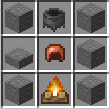
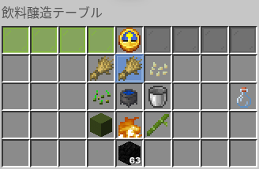

どの酒を作るにおいても必須となる醸造について記載しています。
また、高度な醸造方法については後半に記載しています。

## 醸造方法 - 基本の醸造方法 - 前提

まず、基本的な醸造方法についてです。
醸造は、基本的に熱源の上に設置した大釜で行います。
なお、熱源には着火した火を使用してください。熱源の熱量によってはだめになってしまう酒種もあります

## 醸造方法 - 基本の醸造方法 - 作り方

1. 大釜の中に水を入れます。
2. 水を入れた大釜に酒種を使用します。
3. レシピに則ってリアルタイムで待ちます。
4. 空き瓶で液体を回収します。
5. 醸造完了です。

これで基本的な醸造は完了です。

## 醸造方法 - 高度な醸造方法 - 前提

**ここから制作途中のコンテンツ**

まず高度な醸造を行うには、飲料醸造テーブルが必要です。
飲料醸造テーブのレシピとGUIはこちらです。

飲料醸造テーブルの特徴は以下のとおりです。
・5段階での温度調節ができる
・燃料を必要とする代わりに温度調節ができる
・1分ごとに1つ材料を追加できる

### 飲料醸造テーブル - 温度調節

飲料醸造テーブルの竹アイコンの**空気を吹き入れる**をクリックすることで温度を1段階上げることができます。
温度は、寒い・ほぼ適温ー・適温・ほぼ適温＋、熱い の5段階あり、
寒いや熱いの状態が続くと品質や味などが劣化します。
また、ほぼ適温ーやほぼ適温＋の状態が続いても品質や味などは変わりません
そして適温の状態を維持し続ければ品質や味などが向上します。

### 飲料醸造テーブル - 材料の追加投入

飲料醸造テーブルでは、醸造中の飲料に手持ちのアイテムから追加投入できます。
ただし、飲料の種類によって各材料の相性が異なります。
もちろん投入したタイミングが早いほど追加投入した材料から得られるステータスも増えます。
ただし**一部の相性が悪い材料**を**後期で投入**することで品質や味などを悪化させずにバフだけを得られるという例外もあります。
ただし、連続して同じ材料を入れ続けると**酒種が変わってしまう**こともあります。
さらに、相性が良い材料でも温度が悪いと**逆に品質や味を悪化させてしまう**こともあります。
酒種との相性は次のテーブルのとおりです。

|酒種|相性が良い|相性が悪い|
| :--: | :--: | :--: |
|ビール|小麦・麦芽・米麹|ブドウ全種・芋類・果実全般|
|ワイン|ブドウ全種・果実全般|小麦・麦芽・米麹・芋類|
|テキーラ|小麦・麦芽|米麹・ブドウ全種・果実全般|
|ウォッカ|小麦・麦芽・芋類|米麹|
|日本酒|米麹・麦芽・小麦|果実全般・ブドウ全種|