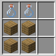
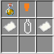

酒を作ったり、飲んだり、交わしたり...あるいはハイスコアを追い求めたり
日ノ本鯖の酒造りは、作って飲むだけでなく作った酒を記録し、販売するところまで楽しめます。

:::note[このガイドの基準]
ガイドは、HNMT-Brewingに実装された機能と初期設定を基にしています。
本番サーバーでの有効状態や設定は未確認です。レシピや酒のプロパティなどが変更されている場合は、ゲーム内の案内を優先してください。
なお、仕様変更がある場合、極力最新の状態に更新します。
:::

:::note[作りかけのコンテンツ]
このガイドは、制作途中のプラグインに関する記事です。
そのため、本記事に関連する記事や内容の一部、一部のコン
テンツについては、未完成や制作途中であり、使えなかった
り、バグが発生したりする可能性があることを熟知した上で
お読みください。
:::

## 酒造りをしよう

1. レシピに則って酒種をクラフトします。
2. 醸造用にセッティングした大釜に酒種をメインハンドで使用します。
3. レシピに則ってリアルタイム時間で放置し、時間になったら空きビンで回収します。
4. 必要に応じて蒸留します。蒸留の指示はレシピに記載してあります。
5. 必要に応じて樽の中に入れて熟成させます。ほとんどのレシピは熟成を必要とします。
6. 任意でノンアルコールにしてください。
7. 完成

ノンアルコールやラベリングは必ずしも必要というわけではありません。
そのまま飲んでも構いません。

## 醸造について

醸造を行うには、火を下につけた大釜に酒種を使うことで行えます。
詳しい内容は[醸造について](../brewing/)

## 蒸留について

蒸留を行うには、燃料を入れたMinecraftの醸造台に飲料とグローストーンダストを入れることで行えます。ただし、飲料醸造テーブルでは行えません。

## 熟成について

醸造または、蒸留を終えた作りかけの飲料を樽の中に入れてMinecraftサーバー内での時間でレシピに記載されている日数待つことで熟成が行なえます。
マイクラ内での1日は3ヶ月分として換算されます。

## ノンアルコールについて

ノンアルコール酒飲料を作るには、通常の制作過程を終えた未ラベリングの飲料をかまどで焼くことでできます。ただし約時間はアルコール飲料のアルコール度数によって変わります。10%なら10秒、50%なら50秒かかります。

## ラベリングについて

ラベリングは、ボトルラベラーという専用作業台を使用して
画像のように配置することで作ることが可能です。
コルク栓は、木のボタン4つでクラフトできます。
酒瓶は、空き瓶4つでクラフトできます。

